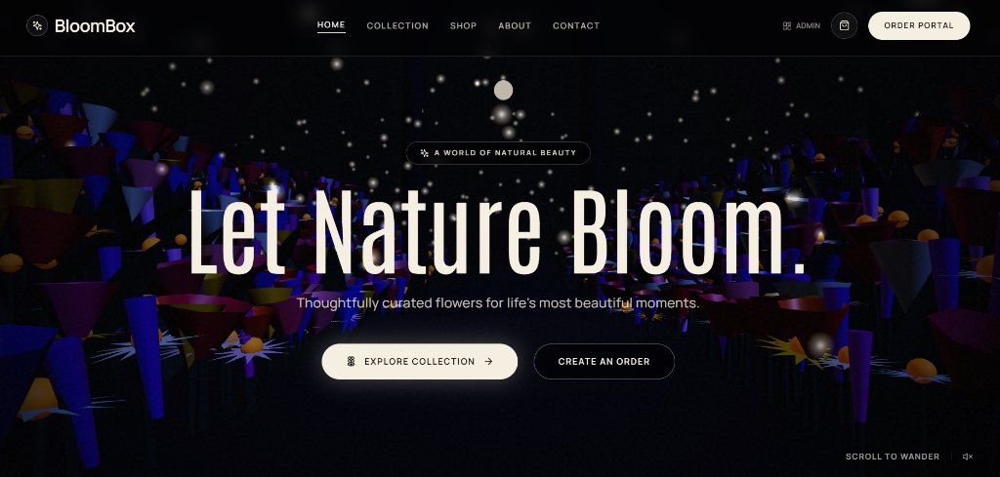
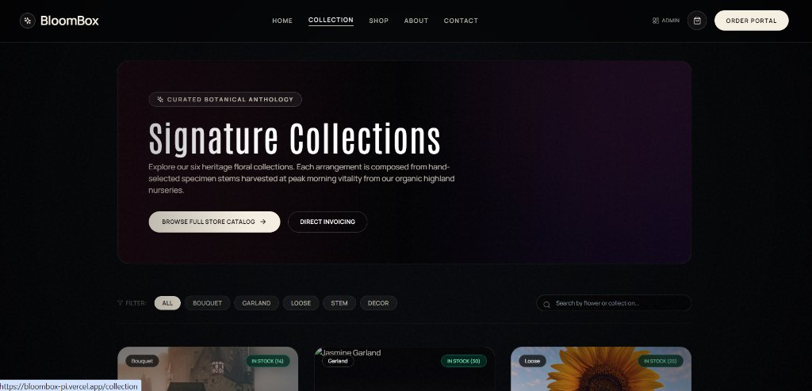
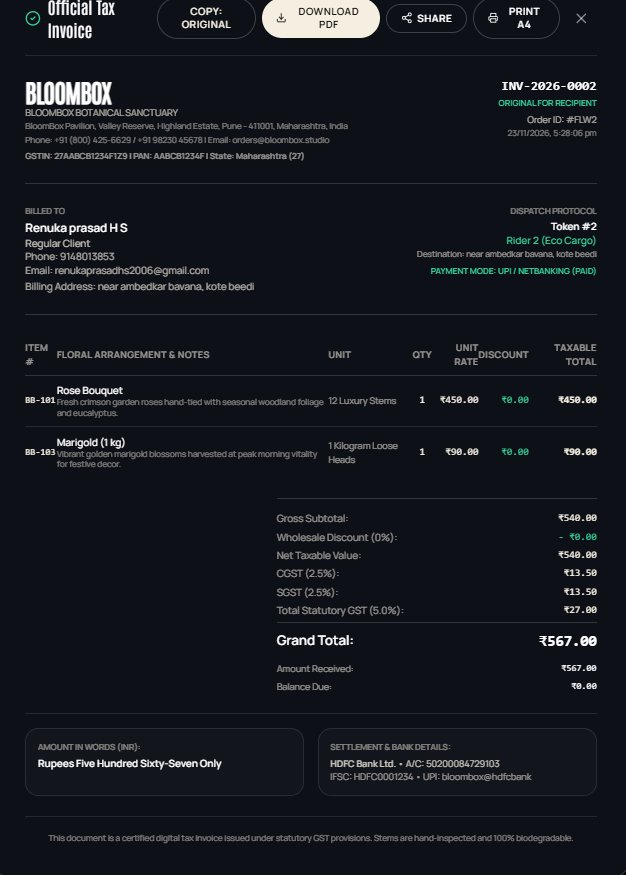
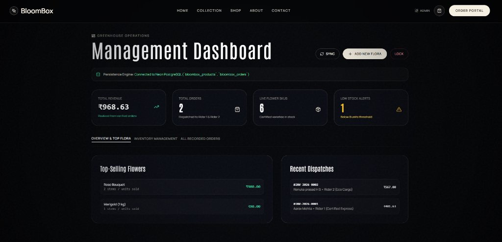
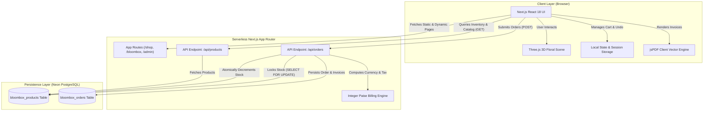
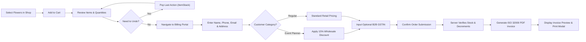
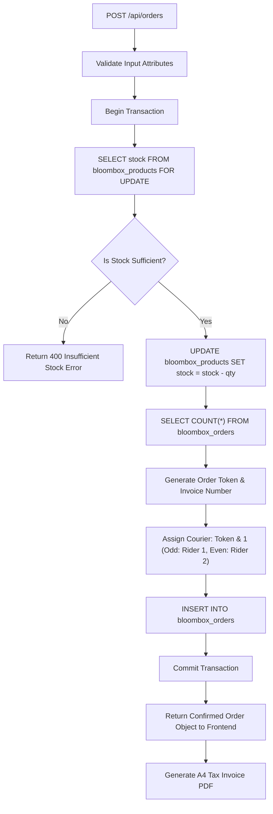
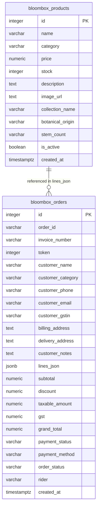

<div align="center">

# 🌸 BloomBox

### Regenerative Botanical Studio, Floral E-Commerce & Precision Dispatch Invoicing Engine

An enterprise-grade, full-stack Next.js web application and botanical inventory management system. Built with Three.js creative 3D floral experiences, Neon serverless PostgreSQL, precision integer-paise billing, and a statutory Indian Tax Invoice (GST) generation engine.

[](https://bloombox-pi.vercel.app)
[](https://github.com/Renukaprasad-dev/BloomBox)
[](https://bloombox-pi.vercel.app)
[](https://nextjs.org/)
[](https://www.typescriptlang.org/)
[](https://neon.tech/)
[](#21-license)

---

**[Explore Live Demo](https://bloombox-pi.vercel.app)** • **[Browse Floral Shop](https://bloombox-pi.vercel.app/shop)** • **[Billing Portal](https://bloombox-pi.vercel.app/bloombox)** • **[Admin Management](https://bloombox-pi.vercel.app/admin)**

---

</div>

## 📑 Table of Contents

- [1. Project Overview](#1-project-overview)
- [2. Key Features](#2-key-features)
- [3. Application Screenshots](#3-application-screenshots)
- [4. System Architecture](#4-system-architecture)
- [5. Application Workflows](#5-application-workflows)
- [6. Technology Stack](#6-technology-stack)
- [7. Database Design & Schema](#7-database-design--schema)
- [8. Business Logic & Financial Rules](#8-business-logic--financial-rules)
- [9. API Documentation](#9-api-documentation)
- [10. Project Directory Structure](#10-project-directory-structure)
- [11. Installation & Local Setup](#11-installation--local-setup)
- [12. Environment Variables](#12-environment-variables)
- [13. Running the Application](#13-running-the-application)
- [14. Automated QA & Invoice Testing](#14-automated-qa--invoice-testing)
- [15. Deployment Guide](#15-deployment-guide)
- [16. Security & Reliability Considerations](#16-security--reliability-considerations)
- [17. Future Roadmap](#17-future-roadmap)
- [18. Contributing](#18-contributing)
- [19. License](#19-license)
- [20. Author & Acknowledgements](#20-author--acknowledgements)

---

## 1. Project Overview

### What is BloomBox?
**BloomBox** is an end-to-end botanical studio, flower e-commerce platform, and automated dispatch management system. It merges an editorial dark-aesthetic creative front-of-house (featuring realistic 3D procedural flower gardens powered by Three.js) with a hardened, statutory-compliant e-commerce back-of-house.

### The Problem It Solves
Traditional floral shops and boutique botanical studios struggle with disjointed software:
1. **Disconnected Systems:** Creative websites cannot accurately reflect greenhouse inventory in real time.
2. **Defective Invoicing:** Off-the-shelf billing templates drop line items, produce malformed PDF byte streams, fail to split GST correctly, and lack Indian legal legal currency representations.
3. **Over-Allocation & Negative Stock:** High-demand floral spikes (weddings, galas) cause race conditions where inventory drops below zero.
4. **Wholesale Pricing Discrepancies:** Event planners requiring bulk allocations need tier-specific wholesale discounting without manual calculation errors.

### Target Users
- **Retail Consumers:** Discerning customers purchasing handcrafted floral bouquets, garlands, and home botanicals.
- **Event Planners & Venues:** Commercial buyers eligible for wholesale pricing (15% wholesale discount) on banquet-scale flower volumes.
- **Studio Florists & Dispatchers:** Operators tracking real-time nursery stock, assigning electric delivery couriers, and generating legal tax invoices.
- **Studio Administrators:** Business managers monitoring master order ledgers, updating SKU rates, and auditing statutory tax collections.

---

## 2. Key Features

### ✅ Implemented & Verified Functionality

| Module | Features & Capabilities | Status |
| :--- | :--- | :---: |
| **Interactive 3D Valley** | Procedural 3D botanical scene utilizing Three.js with realistic geometry for roses, tulips, daisies, lavender, lighting shaders, and ambient floral audio toggle. | Completed |
| **Floral Catalog** | Live 6-product master inventory (`Rose Bouquet`, `Jasmine Garland`, `Marigold`, `Orchid Stem`, `Table Decoration`, `Lily Bunch`) with live stock indicators and origin notes. | Completed |
| **Curated Collections** | Dedicated `/collection` editorial showcasing botanical aesthetics, origin specifications, photography, and one-click cart additions. | Completed |
| **Cart with Undo Stack** | Persistent shopping cart with real-time stock bounds checking and an undo stack (`handleUndoLast`) mirroring the Java `ItemStack` array pop mechanism. | Completed |
| **Billing & Checkout Portal** | Comprehensive checkout supporting Customer Category selection (`Retail Standard` vs `Event Planner`), phone/email validation, and optional B2B Customer GSTIN validation. | Completed |
| **Wholesale Discount Engine** | Automatic 15% wholesale tier deduction applied to line totals for certified Event Planners. | Completed |
| **Statutory 5% GST Engine** | Strict integer-paise tax splitting into 2.5% CGST + 2.5% SGST (or 5.0% IGST) with mathematical balance parity across invoice items. | Completed |
| **Vector Tax Invoice Generator** | ISO 32000-compliant A4 PDF generator via `jsPDF` and `jspdf-autotable` featuring 13-column product table, legal Indian currency words, and HDFC bank details. | Completed |
| **Dual Invoice Mode** | Instant toggle between `ORIGINAL FOR RECIPIENT` and `DUPLICATE FOR TRANSPORTER` copies. | Completed |
| **Order History & Reprints** | Order lookup ledger allowing clients and staff to search orders by ID or customer name and re-download immutable PDF invoices. | Completed |
| **Admin Management Console** | Passcode-secured portal (`/admin`) for inventory management, price adjustments, SKU additions, and master ledger monitoring. | Completed |
| **Atomic Inventory Decrement** | Concurrent safety with PostgreSQL row locking (`SELECT ... FOR UPDATE`) preventing negative stock and race conditions. | Completed |
| **Odd/Even Courier Dispatch** | Automated dispatch token generation: odd tokens allocated to *Rider 1 (Certified Express)*, even tokens to *Rider 2 (Eco Cargo)*. | Completed |
| **Validated Contact Gateway** | Inquiry form on `/contact` with categorized routing (Galas, Wholesale, Custom Commissions). | Completed |

### ⏳ Planned Enhancements
- [ ] Automated payment gateway integration (Razorpay / Stripe Webhooks).
- [ ] Real-time courier GPS tracking via WebSockets.
- [ ] Multi-greenhouse multi-location inventory synchronization.

---

## 3. Application Screenshots

### 1. Homepage — Cinematic Floral Landing Experience

*Interactive 3D procedural flower valley powered by Three.js with realistic botanical geometry and ambient audio.*

---

### 2. Collections — Browse and Filter Floral Products

*Curated botanical anthology showcasing signature flower arrangements, provenance specifications, and category filtering.*

---

### 3. Invoice — Detailed PDF Tax Invoice Preview

*Statutory Indian Tax Invoice (Sec. 31 of CGST Act, 2017) modal preview featuring a 13-column product table, legal currency in words, and HDFC bank settlement details.*

---

### 4. Admin Dashboard — Revenue, Order and Inventory Management

*Greenhouse operations console featuring real-time revenue analytics, active orders, live SKU inventory controls, low-stock alerts, and courier dispatch tracking.*

---

## 4. System Architecture

The BloomBox platform employs a modern full-stack architecture built on the Next.js App Router, backed by Neon Serverless PostgreSQL and client-side WebGL canvas acceleration.



---

## 5. Application Workflows

### Customer Order & Real-Time Checkout Workflow


### Order Confirmation & Inventory Synchronization


---

## 6. Technology Stack

### Frontend & UI
- **Framework:** [Next.js 14.2.35](https://nextjs.org/) (App Router, Server Components, and Client Components)
- **Core Library:** [React 18.3.1](https://react.dev/) & [React DOM 18.3.1](https://react.dev/)
- **Styling:** [Tailwind CSS 3.4.1](https://tailwindcss.com/) with PostCSS 8.4.35 & Autoprefixer 10.4.17
- **3D Graphics:** [Three.js 0.160.0](https://threejs.org/) (WebGL scenes, procedural geometry, lighting shaders)
- **Iconography:** [Lucide React 0.344.0](https://lucide.dev/)
- **Typography:** Google Fonts (`Antonio` uppercase display & `Manrope` body sans)

### Backend & API
- **Runtime:** Node.js v20+ / Serverless Edge Engine
- **Database Driver:** [@neondatabase/serverless 1.2.1](https://neon.tech/docs/serverless/serverless-driver)
- **Parameterized Queries:** `sql.query(query, params)` protocol for serverless PostgreSQL pooling

### Database
- **Platform:** [Neon Serverless PostgreSQL](https://neon.tech/)
- **Features:** Autoscaling compute, connection pooling, JSONB line item storage, atomic row-level locks

### PDF Generation & Document Printing
- **Engine:** [jsPDF 4.2.1](https://github.com/parallax/jsPDF) & [jspdf-autotable 5.0.9](https://github.com/simonbengtsson/jsPDF-AutoTable)
- **Compliance:** ISO 32000 standard binary generation, exact 188mm column budgeting on A4

### Testing & Quality Assurance
- **Verification Suite:** Native Node.js ISO 32000 validation engine
- **Binary & Stream Audit:** [pdf-parse 2.4.5](https://www.npmjs.com/package/pdf-parse) text extraction
- **Type Safety:** TypeScript 5.3.3 (`tsc --noEmit`)
- **Linting:** ESLint 8.57.1 with `eslint-config-next 14.2.23`

### Hosting & Deployment
- **Platform:** [Vercel](https://vercel.com/) (Edge Network, Global Anycast CDN, Serverless Functions)

---

## 7. Database Design & Schema

BloomBox uses two primary relational tables hosted on Neon Serverless PostgreSQL:



### Database Tables Breakdown

#### 1. `bloombox_products` (Master Floral Catalog)
Stores active floral SKUs, retail prices, live greenhouse inventory, botanical origin specifications, and visual presentation properties.
- `id` (INTEGER, Primary Key): Unique SKU identifier (e.g., `101`, `102`).
- `name` (VARCHAR): Product name (`Rose Bouquet`, `Jasmine Garland`).
- `category` (VARCHAR): Botanical category (`Bouquet`, `Garland`, `Loose`, `Stem`, `Decor`).
- `price` (NUMERIC): Base unit price in Indian Rupees (INR).
- `stock` (INTEGER): Live inventory available in greenhouse nursery.
- `description` (TEXT): Full botanical description and arrangement details.
- `image_url` (TEXT): High-resolution botanical photography URL.
- `collection_name` (VARCHAR): Featured collection grouping (`Rose Collection`, `Golden Harvest`).
- `botanical_origin` (VARCHAR): Nursery cultivation origin (e.g., `Highland Mountain Valleys`).
- `stem_count` (VARCHAR): Unit descriptor (e.g., `12 Luxury Stems`, `1 Kilogram Loose Heads`).
- `is_active` (BOOLEAN): Catalog availability toggle.
- `created_at` (TIMESTAMPTZ): SKU record timestamp.

#### 2. `bloombox_orders` (Master Transaction & Invoicing Ledger)
Stores immutable order records, customer information, tax breakdowns, courier dispatch allocations, and full transaction snapshots.
- `id` (INTEGER, Primary Key): Auto-incrementing internal sequence.
- `order_id` (VARCHAR): Client-facing reference (e.g., `FLW1`, `FLW2`).
- `invoice_number` (VARCHAR): Monotonically sequential tax invoice identifier (`INV-2026-0001`).
- `token` (INTEGER): Daily order token used for dispatch priority and courier assignment.
- `customer_name` (VARCHAR): Customer or business name.
- `customer_category` (VARCHAR): Tier identifier (`Regular` or `Event Planner`).
- `customer_phone` (VARCHAR): 10-digit primary contact phone number.
- `customer_email` (VARCHAR): Notification and invoice dispatch email.
- `customer_gstin` (VARCHAR, Nullable): Buyer's B2B GSTIN (for GST input tax credits).
- `billing_address` (TEXT): Official billing street and city address.
- `delivery_address` (TEXT, Nullable): Courier delivery destination address.
- `customer_notes` (TEXT, Nullable): Handling notes and event delivery timeframes.
- `lines_json` (JSONB): Complete immutable snapshot of ordered items, rates, and quantities.
- `subtotal` (NUMERIC): Gross order amount before discounts.
- `discount` (NUMERIC): Deductions applied (e.g., 15% wholesale discount).
- `taxable_amount` (NUMERIC): Net supply value subject to statutory taxation.
- `gst` (NUMERIC): Total 5% Goods and Services Tax.
- `grand_total` (NUMERIC): Final payable total in INR.
- `payment_status` (VARCHAR): `PAID`, `CASH ON DELIVERY`, or `PENDING`.
- `payment_method` (VARCHAR): `UPI / NetBanking`, `Card`, or `Cash on Delivery`.
- `order_status` (VARCHAR): `CONFIRMED`, `OUT FOR DELIVERY`, or `DELIVERED`.
- `rider` (VARCHAR): Assigned courier (`Rider 1 (Certified Express)` or `Rider 2 (Eco Cargo)`).
- `created_at` (TIMESTAMPTZ): Exact UTC timestamp of order placement.

---

## 8. Business Logic & Financial Rules

### 1. Integer-Paise Precision Billing
To prevent IEEE-754 floating point rounding discrepancies (`0.1 + 0.2 !== 0.3`), all financial math operates using integer paise (`1 INR = 100 paise`):
$$\text{lineTotalPaise} = \text{quantity} \times \text{Math.round}(\text{unitPrice} \times 100)$$
$$\text{subtotalPaise} = \sum \text{lineTotalPaise}$$

### 2. Wholesale Tier Discounts
- **Regular Customer:** `0% discount` ($Rate = 0.00$).
- **Event Planner:** `15% wholesale discount` ($Rate = 0.15$).
$$\text{discountPaise} = \text{Math.round}(\text{subtotalPaise} \times 0.15)$$
$$\text{taxableAmountPaise} = \text{subtotalPaise} - \text{discountPaise}$$

### 3. Statutory GST (5.0%) Intra-State Parity
Orders under Maharashtra jurisdiction (State Code: `27`) undergo dual statutory tax splitting:
$$\text{gstPaise} = \text{Math.round}(\text{taxableAmountPaise} \times 0.05)$$
$$\text{cgstPaise} = \lfloor \text{gstPaise} / 2 \rfloor \quad (2.5\% \text{ Central Tax})$$
$$\text{sgstPaise} = \text{gstPaise} - \text{cgstPaise} \quad (2.5\% \text{ State Tax})$$
$$\text{grandTotalPaise} = \text{taxableAmountPaise} + \text{gstPaise}$$

### 4. Indian Legal Currency Format (Words)
Amounts are converted into official Indian English legal tender strings using Crore, Lakh, Thousand, Hundred, and Paise formatting:
- *Example:* ₹1,124.55 $\rightarrow$ `"Rupees One Thousand One Hundred Twenty-Four and Fifty-Five Paise Only"`
- *Example:* ₹472.50 $\rightarrow$ `"Rupees Four Hundred Seventy-Two and Fifty Paise Only"`

### 5. Odd/Even Courier Dispatch Allocation
Orders are dynamically routed based on bitwise token parity:
- **Odd Token (`token & 1 === 1`):** Routed to **Rider 1 (Certified Express)** for rapid single-destination deliveries.
- **Even Token (`token & 1 === 0`):** Routed to **Rider 2 (Eco Cargo)** for grouped wholesale and eco-transport deliveries.

---

## 9. API Documentation

### Base URL: `https://bloombox-pi.vercel.app/api`

| Method | Endpoint | Description | Request Body / Parameters | Response Status |
| :--- | :--- | :--- | :--- | :---: |
| `GET` | `/api/products` | Retrieve all active catalog flowers | None | `200 OK` |
| `POST` | `/api/products` | Update price or create product SKU | `{ action, passcode, productId, newPrice, product }` | `200 OK` / `401 Unauthorized` |
| `GET` | `/api/orders` | Fetch master order ledger | Query params: `search`, `category`, `status` | `200 OK` |
| `POST` | `/api/orders` | Confirm order, lock stock, create invoice | `{ customerName, customerCategory, customerPhone, customerEmail, customerGstin, billingAddress, lines, paymentMethod }` | `200 OK` / `400 Bad Request` |

### API Request & Response Examples

#### 1. Place Order (`POST /api/orders`)
**Request Headers:** `Content-Type: application/json`  
**Request Payload:**
```json
{
  "customerName": "Aarav Mehta",
  "customerCategory": "Event Planner",
  "customerPhone": "+91 9876543210",
  "customerEmail": "aarav@eventplanner.in",
  "customerGstin": "27AAPFU0939F1ZV",
  "billingAddress": "Suite 104, Business Bay, Pune 411006",
  "lines": [
    {
      "item": {
        "id": 101,
        "name": "Rose Bouquet",
        "category": "Bouquet",
        "price": 450
      },
      "quantity": 2
    }
  ],
  "paymentMethod": "UPI / NetBanking"
}
```

**Success Response (`200 OK`):**
```json
{
  "success": true,
  "order": {
    "orderId": "FLW1",
    "invoiceNumber": "INV-2026-0001",
    "token": 1,
    "customerName": "Aarav Mehta",
    "customerCategory": "Event Planner",
    "customerType": "Event Planner",
    "customerPhone": "+91 9876543210",
    "customerEmail": "aarav@eventplanner.in",
    "customerGstin": "27AAPFU0939F1ZV",
    "billingAddress": "Suite 104, Business Bay, Pune 411006",
    "subtotal": 900.00,
    "discount": 135.00,
    "taxableAmount": 765.00,
    "gst": 38.25,
    "finalTotal": 803.25,
    "grandTotal": 803.25,
    "paymentStatus": "PAID",
    "paymentMethod": "UPI / NetBanking",
    "orderStatus": "CONFIRMED",
    "rider": "Rider 1 (Certified Express)",
    "timestamp": "23/11/2026, 4:59:42 pm"
  }
}
```

---

## 10. Project Directory Structure

```
bloombox/
├── .eslintrc.json               # ESLint configuration with Next.js core web vitals
├── .gitignore                   # Excludes node_modules, .next, .env*.local, and test binaries
├── .env.example                 # Safe environment configuration template
├── package.json                 # Project dependencies, build, lint, and test scripts
├── tsconfig.json                # TypeScript compiler configuration
├── tailwind.config.ts           # Tailwind typography and theme design tokens
├── postcss.config.js            # PostCSS plugin definitions
├── next.config.mjs              # Next.js optimization and image remote patterns
│
├── app/                         # Next.js App Router (Pages, Layouts & APIs)
│   ├── layout.tsx               # Root application layout with fonts and metadata
│   ├── page.tsx                 # Cinematic Homepage with Three.js 3D Floral Valley
│   ├── globals.css              # Global styles, film grain, and custom scrollbars
│   ├── icon.svg                 # SVG brand favicon
│   ├── about/
│   │   └── page.tsx             # Studio philosophy, sustainable greenhouse story
│   ├── admin/
│   │   └── page.tsx             # Passcode-gated inventory & master ledger console
│   ├── bloombox/
│   │   └── page.tsx             # Core Checkout, Cart, Invoicing Portal & Modal
│   ├── collection/
│   │   └── page.tsx             # Curated botanical collections with modal details
│   ├── contact/
│   │   └── page.tsx             # Studio inquiry and commission booking form
│   ├── shop/
│   │   └── page.tsx             # Floral catalog with direct-to-cart purchasing
│   └── api/
│       ├── orders/
│       │   └── route.ts         # Serverless GET & POST endpoints for orders
│       └── products/
│           └── route.ts         # Serverless GET & POST endpoints for products
│
├── components/                  # Modular React UI Components
│   ├── Header.tsx               # Global navigation bar with live cart count pill
│   ├── Footer.tsx               # Studio brand footer with operating hours
│   ├── HeroSection.tsx          # Editorial hero with typography and CTAs
│   ├── ValleyScene.tsx          # Procedural 3D botanical Three.js canvas
│   ├── LoadingScreen.tsx        # Ambient studio preload overlay
│   └── SoundToggle.tsx          # Ambient garden audio synthesizer toggle
│
├── lib/                         # Core Business Logic & Infrastructure
│   ├── billingCalculations.ts   # Integer-paise finance, GST split, and legal words
│   ├── db.ts                    # Neon Serverless PostgreSQL connection and pooling
│   ├── pdfInvoice.ts            # jsPDF A4 statutory 13-column tax invoice generator
│   └── store.ts                 # Shared state interfaces, local fallbacks, catalog defaults
│
├── bloombox/                    # Original Java 17 Console Application
│   ├── src/bloombox/
│   │   ├── app/BloomBox.java    # Original menu-driven CLI order runner
│   │   ├── model/               # Customer, FlowerItem, ItemStack, Order classes
│   │   └── exceptions/          # InsufficientStockException class
│   └── README.md                # Java curriculum and syllabus documentation
│
├── public/                      # Static Web Assets
│   └── favicon.svg              # Studio botanical flower mark
│
└── tests/                       # Automated QA Verification Suites
    └── invoice_test_suite.js    # 15-scenario PDF extraction and financial math test
```

---

## 11. Installation & Local Setup

### Prerequisites
- **Node.js:** v18.18.0 or newer (v20+ recommended)
- **Package Manager:** `npm` (v9+) or `pnpm`
- **Git:** Installed and configured
- **Database:** Neon PostgreSQL account (or local PostgreSQL instance)

### Setup Instructions

1. **Clone the Repository:**
   ```bash
   git clone https://github.com/Renukaprasad-dev/BloomBox.git
   cd BloomBox
   ```

2. **Install Dependencies:**
   ```bash
   npm install
   ```

3. **Configure Environment Variables:**
   Copy `.env.example` to `.env.local`:
   ```bash
   # Linux / macOS
   cp .env.example .env.local

   # Windows PowerShell
   Copy-Item .env.example .env.local
   ```
   Open `.env.local` and add your database connection string and credentials.

4. **Initialize Database Tables:**
   Execute the following SQL in your Neon Console or PostgreSQL client:
   ```sql
   CREATE TABLE IF NOT EXISTS bloombox_products (
     id INTEGER PRIMARY KEY,
     name VARCHAR(255) NOT NULL,
     category VARCHAR(100) NOT NULL,
     price NUMERIC(10, 2) NOT NULL,
     stock INTEGER NOT NULL,
     description TEXT,
     image_url TEXT,
     collection_name VARCHAR(255),
     botanical_origin VARCHAR(255),
     stem_count VARCHAR(100),
     is_active BOOLEAN DEFAULT TRUE,
     created_at TIMESTAMPTZ DEFAULT CURRENT_TIMESTAMP
   );

   CREATE TABLE IF NOT EXISTS bloombox_orders (
     id SERIAL PRIMARY KEY,
     order_id VARCHAR(64) NOT NULL,
     invoice_number VARCHAR(64) NOT NULL,
     token INTEGER NOT NULL,
     customer_name VARCHAR(255) NOT NULL,
     customer_category VARCHAR(64) NOT NULL,
     customer_phone VARCHAR(64),
     customer_email VARCHAR(255),
     customer_gstin VARCHAR(32),
     billing_address TEXT NOT NULL,
     delivery_address TEXT,
     customer_notes TEXT,
     lines_json JSONB NOT NULL,
     subtotal NUMERIC(10, 2) NOT NULL,
     discount NUMERIC(10, 2) NOT NULL,
     taxable_amount NUMERIC(10, 2) NOT NULL,
     gst NUMERIC(10, 2) NOT NULL,
     grand_total NUMERIC(10, 2) NOT NULL,
     payment_status VARCHAR(64) NOT NULL,
     payment_method VARCHAR(64) NOT NULL,
     order_status VARCHAR(64) NOT NULL,
     rider VARCHAR(128) NOT NULL,
     created_at TIMESTAMPTZ DEFAULT CURRENT_TIMESTAMP
   );
   ```

5. **Start Development Server:**
   ```bash
   npm run dev
   ```
   Open [http://localhost:3000](http://localhost:3000) in your browser.

---

## 12. Environment Variables

BloomBox utilizes the following environment variables:

| Variable Name | Required | Default / Safe Fallback | Purpose |
| :--- | :---: | :--- | :--- |
| `DATABASE_URL` | Yes | Local in-memory fallback | Neon Serverless PostgreSQL connection string with SSL mode |
| `ADMIN_PASSCODE` | No | `bloombox@2026` | Passcode protection for `/admin` operations |
| `NEXT_PUBLIC_STUDIO_GSTIN` | No | `27AABCB1234F1Z9` | Studio GSTIN displayed on Tax Invoices and headers |

*See [.env.example](file:///.env.example) for placeholder values. Never commit `.env.local` to version control.*

---

## 13. Running the Application

| Action | Command | Purpose |
| :--- | :--- | :--- |
| **Development** | `npm run dev` | Starts local Next.js dev server on `http://localhost:3000` |
| **Type Check** | `npx tsc --noEmit` | Validates TypeScript types across the entire project |
| **Linting** | `npm run lint` | Runs Next.js ESLint inspection |
| **Test Suite** | `npm test` | Runs the 15-test automated invoice & QA test suite |
| **Production Build** | `npm run build` | Compiles and optimizes assets for production deployment |
| **Production Start** | `npm start` | Launches production build locally |

---

## 14. Automated QA & Invoice Testing

BloomBox includes a comprehensive automated test suite in `tests/invoice_test_suite.js` that tests financial precision, binary formatting, and PDF text extraction.

### Execute Tests
```bash
npm test
```

### Verified Test Results (15/15 Passed — 100% Success)
```
====================================================
BLOOMBOX COMPREHENSIVE QA & INVOICE ENGINE TEST SUITE
====================================================

[PASS] TEST 1: One product, quantity 1, regular customer — Subtotal: Rs. 450, GST: Rs. 22.5, Grand Total: Rs. 472.5
[PASS] TEST 2: Multiple products with different quantities — Subtotal: Rs. 1260, Grand Total: Rs. 1323
[PASS] TEST 3: Event Planner with 15% wholesale discount — Subtotal: Rs. 1260, Discount: -Rs. 189, Taxable: Rs. 1071, Total: Rs. 1124.55
[PASS] TEST 4: GST statutory breakdown parity — CGST (2.5%): Rs. 26.77 + SGST (2.5%): Rs. 26.78 === Total GST: Rs. 53.55
[PASS] TEST 5: Integer paise consistency & legal amount in words — Total: 112455p (Rupees One Thousand One Hundred Twenty-Four and Fifty-Five Paise Only)
[PASS] TEST 6: Empty cart handles gracefully with zero totals
[PASS] TEST 7: Fallback defaults for missing customer attributes render safely without crash
[PASS] TEST 8: Long multi-line address wraps without clipping or overflow
[PASS] TEST 9: Large multi-item order generates clean multi-page document — Generated 2 pages with repeated headers
[PASS] TEST 10: PDF binary stream generated and saved to disk — File size: 66155 bytes
[PASS] TEST 11: Text extraction verifies authentic presence of all required fields — Verified: Studio name, GSTIN, TAX INVOICE header, Floral SKU, Grand Total
[PASS] TEST 12: PDF ISO 32000 specification integrity (valid header, xref, and EOF) — Header: %PDF-1.3, Length: 66155 bytes
[PASS] TEST 13: Invoice number uniqueness and sequential monotonicity — INV-2026-0001, INV-2026-0002, INV-2026-0003, INV-2026-0004, INV-2026-0005
[PASS] TEST 14: Historical re-download preserves immutable order snapshot across catalog changes — Original Total preserved: Rs. 472.5
[PASS] TEST 15: Inventory decrements atomically by exact ordered quantity — Initial: 15, Purchased: 3, Remaining: 12

====================================================
TEST SUITE RESULTS: 15/15 TESTS PASSED (100% SUCCESS)
====================================================
```

---

## 15. Deployment Guide

The application is deployed on **Vercel** with a connection to **Neon Serverless PostgreSQL**.

### Deploying to Vercel

1. **Install Vercel CLI:**
   ```bash
   npm install -g vercel
   ```

2. **Link Project & Set Environment Variables:**
   ```bash
   vercel link
   vercel env add DATABASE_URL
   vercel env add ADMIN_PASSCODE
   vercel env add NEXT_PUBLIC_STUDIO_GSTIN
   ```

3. **Deploy to Production:**
   ```bash
   vercel --prod
   ```

### Verified Live Production Details
- **Live URL:** [https://bloombox-pi.vercel.app](https://bloombox-pi.vercel.app)
- **Deployment Status:** `READY` (HTTP 200 OK verified across all routes)
- **Database Status:** Connected to Neon PostgreSQL (`eu-west-2` AWS Region)

---

## 16. Security & Reliability Considerations

1. **Zero Credential Exposure:** All database strings, admin credentials, and API secrets are isolated in `.env.local` and Vercel Encrypted Secrets. `.gitignore` prevents leaks.
2. **SQL Injection Prevention:** Every query in [lib/db.ts](file:///c:/Users/Msc/Downloads/bloombox/lib/db.ts) and API routes utilizes parameterized bindings via `sql.query(query, params)`.
3. **Atomic Concurrency Protection:** Stock allocation uses `SELECT ... FOR UPDATE` inside transactions to prevent inventory over-selling during concurrent checkout attempts.
4. **Input Sanitization & Validation:** Email, phone, address, and quantity fields undergo regex and range validation on both client and server before invoice generation.
5. **Passcode-Gated Admin Operations:** Product modifications and price overrides require the session-authenticated `ADMIN_PASSCODE`.

---

## 17. Future Roadmap

- [ ] **Payment Gateway:** Integration of Razorpay and Stripe with webhook verification.
- [ ] **Email Dispatch:** Automatic delivery of PDF tax invoices via SendGrid / Resend.
- [ ] **SMS Notifications:** Automated WhatsApp/SMS alerts containing courier dispatch details and delivery tokens.
- [ ] **Multi-Currency Support:** Currency localization for international floral gifting orders.

---

## 18. Contributing

Contributions are welcome! Please follow these steps:

1. **Fork the Repository:** Click the "Fork" button on GitHub.
2. **Create a Feature Branch:**
   ```bash
   git checkout -b feature/your-feature-name
   ```
3. **Commit Your Changes:**
   ```bash
   git commit -m "feat: describe your feature clearly"
   ```
4. **Push to Your Branch:**
   ```bash
   git push origin feature/your-feature-name
   ```
5. **Open a Pull Request:** Submit your PR against the `main` branch with a clear description of changes.

---

## 19. License

No license has been specified for this project. All rights are reserved by the author. Contact the author for commercial use or distribution permissions.

---

## 20. Author & Acknowledgements

**Author:** Renukaprasad HS  
**GitHub:** [@Renukaprasad-dev](https://github.com/Renukaprasad-dev)  
**Project Repository:** [https://github.com/Renukaprasad-dev/BloomBox](https://github.com/Renukaprasad-dev/BloomBox)  
**Live Application:** [https://bloombox-pi.vercel.app](https://bloombox-pi.vercel.app)

*Special thanks to the Google DeepMind team, the Next.js community, and the open-source contributors of Three.js and jsPDF.*
